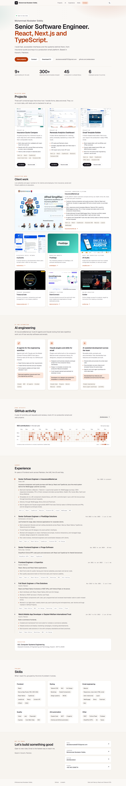
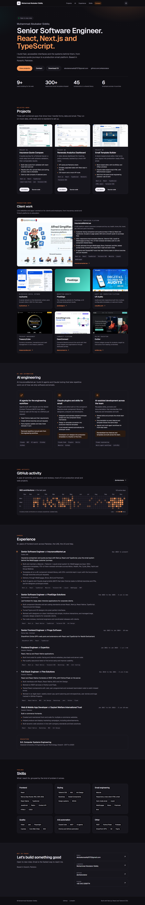
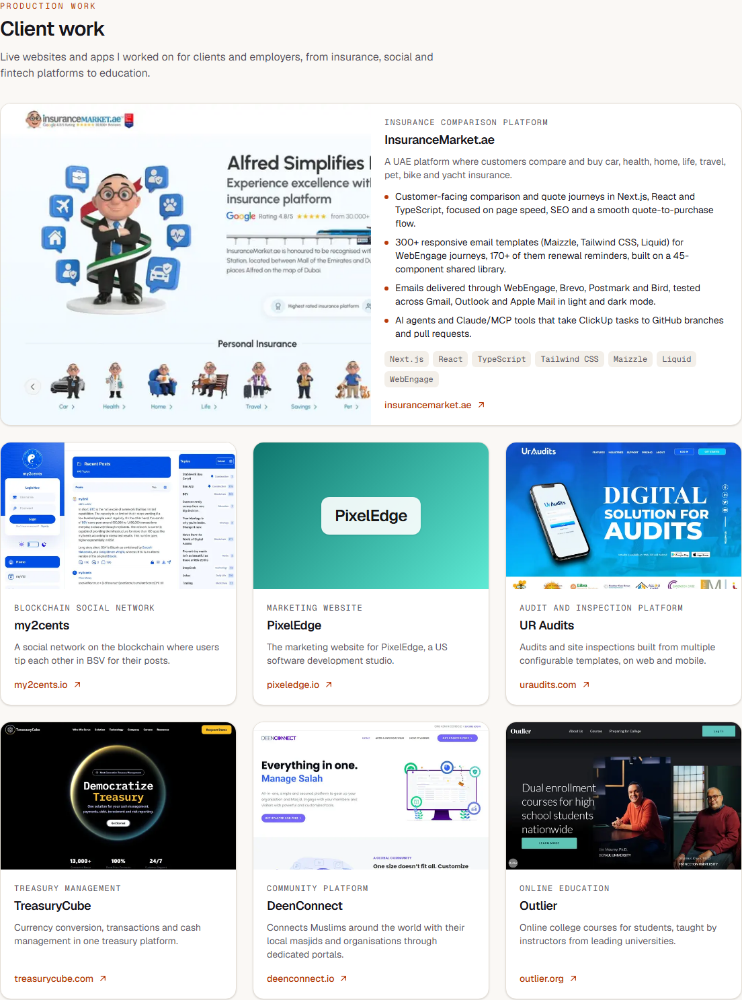
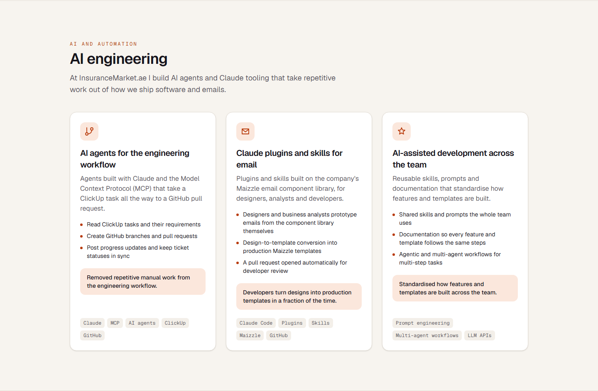
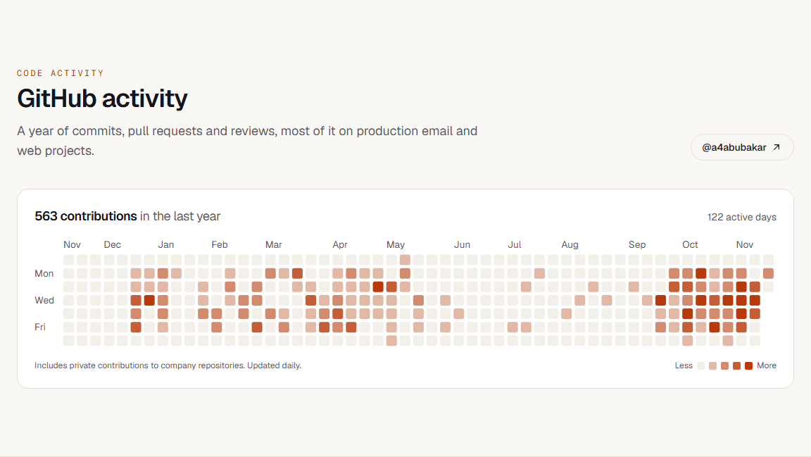

# Portfolio: Muhammad Abubaker Siddiq

The personal portfolio of a Senior Software Engineer (React, Next.js, React Native, TypeScript): portfolio projects,
client work, AI engineering, a live GitHub contribution chart, experience, skills and contact. Statically rendered,
dark mode, accessible, with SEO metadata and a generated Open Graph image.

- Live site: https://portfolio-next-six-tau.vercel.app
- Source: https://github.com/a4abubakar/portfolio-next

|  | Light | Dark |
|---|---|---|
| **Desktop** |  |  |
| **Mobile (390px)** |  |  |

## Sections

| Section | What it shows |
|---|---|
| Hero | Name, "Senior Software Engineer" headline, View projects / Contact / Download CV, email and GitHub links, four headline numbers |
| Projects | Three portfolio apps with screenshots, live demo and source links: [Insurance Quote Compare](https://quote-compare-xi.vercel.app), [Renewals Analytics Dashboard](https://data-dashboard-rose-iota.vercel.app), [Email Template Builder](https://email-builder-omega-neon.vercel.app) |
| Client work | Seven production platforms: InsuranceMarket.ae as a featured full-width card with what I built there, plus my2cents, PixelEdge, UR Audits, TreasuryCube, DeenConnect and Outlier |
| AI engineering | AI agents (Claude + MCP) that take ClickUp tasks to GitHub pull requests, Claude plugins and skills for the email workflow, and AI-assisted development across the team |
| GitHub activity | Contribution calendar for the last 12 months, refreshed daily |
| Experience | Timeline of six roles (2017 to present) and education |
| Skills | Six groups: frontend, styling, email engineering, quality, AI and automation, other |
| Contact | Email, LinkedIn, GitHub and phone; CV at `/cv.pdf` |







## Features

- All content lives in typed data files in `src/data/`, so updating a project, client, job or link is a one-line change.
- **GitHub contribution chart** drawn as an SVG in the site's own colours (light and dark), with a tooltip per day,
  a legend and a text summary for screen readers. Data comes from a public contributions API and is cached for a day
  with `"use cache"` and `cacheLife("days")`, so the page stays static and refreshes itself daily. If the source is
  down, the section shows a link to the GitHub profile instead. On small screens the chart scrolls inside its card
  and opens on the latest months.
- **Client work** cards use screenshots of the live sites; a client with detailed highlights gets a full-width
  featured card. A client without a screenshot gets a generated gradient card.
- Dark mode: class-based toggle that follows the system by default, remembers an explicit choice and applies before
  first paint (no flash).
- Active nav link tracking with `IntersectionObserver`; the five-item nav fits a 360px screen without overflow.
- SEO: title template, description, Open Graph and Twitter tags, canonical URL, `sitemap.xml`, `robots.txt`, a
  generated 1200x630 Open Graph image and `schema.org/Person` JSON-LD with the GitHub and LinkedIn profiles.
- The home page is prerendered and revalidated once a day; `loading.tsx`, `error.tsx` and `not-found.tsx` are included.

## Tech stack

Next.js 16 (App Router, Cache Components), React 19, TypeScript (strict), Tailwind CSS v4, Vitest 5 with Testing
Library, Playwright 1.65. No runtime dependencies beyond Next and React. Deployed on Vercel.

## Key decisions

- **Server Components by default.** Only the theme toggle and the header (scroll-spy) are client components;
  everything else, including the GitHub chart, renders on the server.
- **Own SVG chart instead of an embedded image.** Third-party chart images can't follow the site theme, aren't
  accessible and add a tracking request. The SVG is about 370 rectangles, themed with CSS variables, and has a real
  text alternative. Trade-off: it depends on a community API for the daily counts (GitHub's own API needs a token).
- **Private contributions included.** Most of the work is in private company repositories; the chart says so under
  the calendar.
- **Content as typed data, not a CMS.** A CMS would be overkill for one page. Trade-off: edits need a redeploy.
- **Own theme script instead of `next-themes`.** About ten lines inline in `<head>`, one fewer dependency.
- **Current-role durations and the footer year are not rendered**, because they would go stale in a static build
  (`new Date()` isn't allowed during prerender with Cache Components).

## Project structure

```
src/
  app/            layout, page, icon, Open Graph image, sitemap, robots, loading/error/not-found
  components/     Header, Hero, ProjectsSection, ClientWork, AiSection, GitHubSection, GitHubActivity,
                  ExperienceSection, SkillsSection, ContactSection, Footer, ProjectCard, SafeLink, ThemeToggle
  data/           profile.ts, projects.ts, clients.ts, ai.ts, experience.ts, skills.ts
  lib/            github (contribution data), dates, links, theme, jsonld helpers
public/           cv.pdf, project and client screenshots
tests/            Vitest unit and component tests
e2e/              Playwright spec
scripts/          screenshots.mjs
docs/screenshots/ README images
```

## How to run

```bash
npm install
npm run dev          # http://localhost:3000
npm run lint
npm run typecheck
npm test             # Vitest: 30 tests
npm run test:e2e     # Playwright: 9 tests; serves the app on port 3000 (or reuses a running one)
npm run build && npm run start
```

Set `NEXT_PUBLIC_SITE_URL` when deploying to another domain so canonical, sitemap and Open Graph URLs are correct
(the fallback is the Vercel URL above).

Deploy (manual until the Vercel GitHub app is connected):

```bash
npx vercel deploy --prod --yes --scope a4abubakars-projects
```

### Playwright and screenshots on this machine

`playwright.config.ts` and `scripts/screenshots.mjs` use `channel: "msedge"` because the bundled Chromium headless
shell fails to launch on the Windows machine this was built on ("spawn UNKNOWN"). CI and other machines can delete
the `channel` line and use the Playwright-installed Chromium.

To regenerate the README images, serve the app (`npm run build && npm run start`) and run `npm run screenshots`. It
saves the four full-page shots plus close-ups of the client work, AI and GitHub sections.

## Updating content

| To change | Edit |
|---|---|
| Name, headline, contact details, hero numbers | `src/data/profile.ts` |
| Portfolio projects | `src/data/projects.ts` (screenshots in `public/projects/`) |
| Client work | `src/data/clients.ts` (screenshots in `public/clients/`) |
| AI engineering cards | `src/data/ai.ts` |
| Jobs and education | `src/data/experience.ts`, `src/data/profile.ts` |
| Skills | `src/data/skills.ts` |
| CV download | replace `public/cv.pdf` |
| GitHub chart account | `githubUrl` in `src/data/profile.ts` |

## Accessibility notes

- Landmarks (`header`, `nav`, `main`, `footer`), one `h1`, ordered headings, a skip link, labelled sections and list
  semantics for the timeline and cards.
- Visible focus ring on every interactive element; the whole page is keyboard operable, including the scrollable
  chart region.
- The contribution chart has a text summary (`role="img"` with a description of the year, active days and busiest
  day); the colour legend is decorative.
- The theme toggle is a real button with `aria-pressed`; the current section in the nav uses `aria-current="location"`.
- Colour tokens were chosen for AA contrast in both themes.
- `prefers-reduced-motion` disables the entrance animation, the pulsing dot and smooth scrolling.

## What I'd do next

- Short case-study pages for the portfolio projects and the AI agents.
- An automated axe check in the Playwright spec and a Lighthouse CI budget.
- Connect the Vercel GitHub app so every push deploys.
- A custom domain.

## Author

**Muhammad Abubaker Siddiq**, Senior Software Engineer (React, Next.js, React Native, TypeScript)

- GitHub: [@a4abubakar](https://github.com/a4abubakar)
- Portfolio: https://portfolio-next-six-tau.vercel.app
- LinkedIn: https://www.linkedin.com/in/muhammad-abubaker-siddiq-27b37615b
