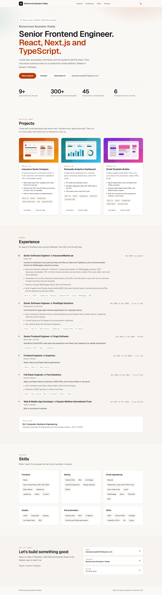
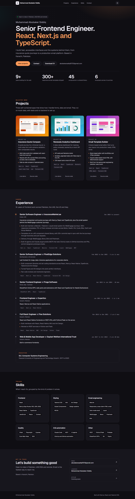
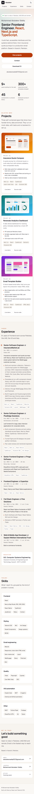
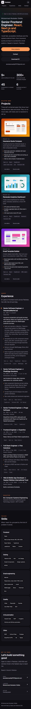

# Portfolio: Muhammad Abubaker Siddiq

A fast, statically rendered personal portfolio for a Senior Frontend Engineer (React, Next.js, TypeScript): hero, projects, experience timeline, skills and contact, with dark mode, SEO metadata and a generated Open Graph image.

|  | Light | Dark |
|---|---|---|
| **Desktop** |  |  |
| **Mobile (390px)** |  |  |

- Live demo: `TODO`
- GitHub: `TODO`

## Features

- Single page with five sections: hero with calls to action (View projects, Contact, Download CV), Projects, Experience timeline, Skills and Contact.
- All content lives in typed data files in `src/data/`, so updating a project link or a job is a one-line change.
- Dark mode: class-based toggle that follows the system by default, remembers an explicit choice and applies before first paint (no flash).
- Active nav link tracking with `IntersectionObserver`; the mobile nav sits on its own row, so nothing overflows at 360px.
- Project links stay as clear "coming soon" placeholders until a real URL is set (no dead `href="TODO"`).
- SEO: title template, description, Open Graph and Twitter tags, canonical URL, `sitemap.xml`, `robots.txt`, a generated 1200x630 Open Graph image and `schema.org/Person` JSON-LD.
- Every route is statically prerendered; `loading.tsx`, `error.tsx` and `not-found.tsx` are included.

## Tech stack

Next.js 16 (App Router, Cache Components), React 19, TypeScript (strict), Tailwind CSS v4, Vitest 5 with Testing Library, Playwright 1.65. Geist fonts through `next/font`. No runtime dependencies beyond Next and React.

## Key decisions

- **Server Components by default.** Only the theme toggle and the header (scroll-spy) are client components; everything else renders at build time.
- **Content as typed data, not a CMS.** A CMS would be overkill for one page. Trade-off: edits need a rebuild.
- **Placeholder links are data-driven.** `isPlaceholderUrl()` decides at render time, so setting a real URL in `src/data/projects.ts` is all it takes to turn a "coming soon" pill into a link.
- **Own theme script instead of `next-themes`.** About ten lines inline in `<head>`, one fewer dependency. Trade-off: less battle-tested than the library.
- **Current-role durations are not rendered.** "2 yrs 10 mos" would go stale in a static build, so only finished roles show a duration.
- **No year in the footer**, for the same reason (`new Date()` is not allowed during prerender with Cache Components).
- **Generated SVG project art** keeps the repo small and works offline until real screenshots exist.

## Project structure

```
src/
  app/            layout, page, icon, Open Graph image, sitemap, robots, loading/error/not-found
  components/     Header, Hero, sections, ProjectCard, ProjectArt, SafeLink, ThemeToggle
  data/           profile.ts, projects.ts, experience.ts, skills.ts
  lib/            dates, links, theme, jsonld helpers
tests/            Vitest unit and component tests
e2e/              Playwright spec
scripts/          screenshots.mjs
docs/screenshots/ README images
```

## How to run

```bash
npm install
npm run dev          # http://localhost:3000
npm run lint
npm run typecheck
npm test             # Vitest
npm run test:e2e     # Playwright; builds and serves the production app on port 3000 (or reuses a running one)
npm run build && npm run start
```

Set `NEXT_PUBLIC_SITE_URL` (for example `https://your-domain.example`) when deploying so canonical, sitemap and Open Graph URLs are correct.

### Playwright and screenshots on this machine

`playwright.config.ts` and `scripts/screenshots.mjs` use `channel: "msedge"` because the bundled Chromium headless shell fails to launch on the Windows machine this was built on ("spawn UNKNOWN"). CI and other machines can delete the `channel` line and use the Playwright-installed Chromium.

To regenerate the README images, serve the app (`npm run build && npm run start`) and run `npm run screenshots`.

## Things to fill in

1. **GitHub profile URL**: `githubUrl` in `src/data/profile.ts`. The Contact section and JSON-LD pick it up automatically.
2. **Project links**: `liveUrl` and `repoUrl` per project in `src/data/projects.ts`.
3. **CV**: drop the PDF at `public/cv.pdf`. The "Download CV" button already points to `/cv.pdf` and will work as soon as the file exists (until then it returns a 404).
4. **Project screenshots**: the sibling projects save screenshots to `..\<project>\docs\screenshots\`. Copy the one you want into `public/projects/` (for example `public/projects/quote-compare.png`) and set `image: "/projects/quote-compare.png"` on that project. When `image` is set, the generated placeholder is replaced by a `next/image` with the screenshot, cropped from the top.

## Accessibility notes

- Landmarks (`header`, `nav`, `main`, `footer`), one `h1`, ordered headings, a skip link, labelled sections and list semantics for the timeline.
- Visible focus ring on every interactive element; the whole page is keyboard operable.
- The theme toggle is a real button with `aria-pressed`; the current section in the nav uses `aria-current="location"`.
- Colour tokens were chosen for AA contrast in both themes; accent colours differ between light and dark for that reason.
- `prefers-reduced-motion` disables the entrance animation, the pulsing dot and smooth scrolling.
- Placeholder links are announced as "coming soon" and are not focusable.
- Decorative SVGs are `aria-hidden`; the project placeholders have descriptive labels.

## What I'd do next

- Real screenshots and deploy links for the three projects, plus short case-study pages.
- An automated axe check in the Playwright spec and a Lighthouse CI budget.
- A print stylesheet so the page doubles as a CV when `cv.pdf` is not available.
- A small "copy email" button with an `aria-live` confirmation.
